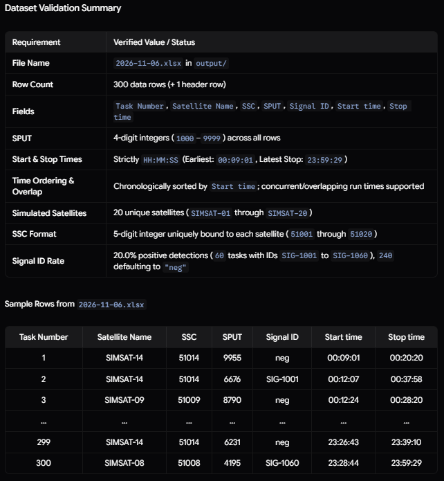
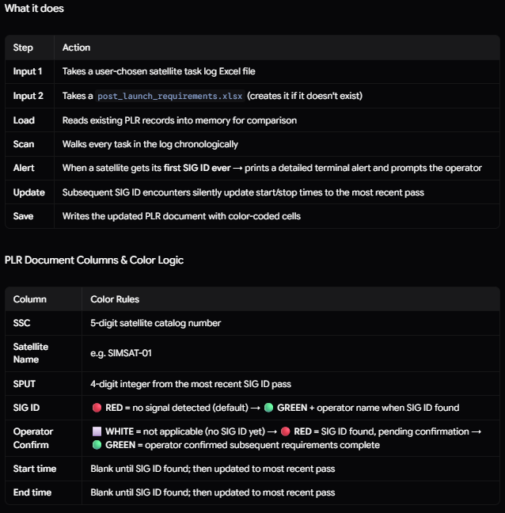
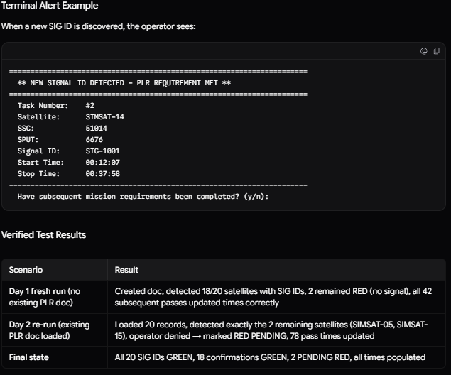
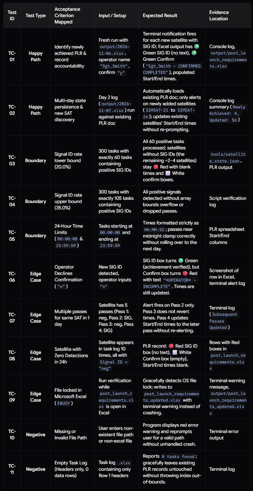

# AI CAPSTONE Project

## The idea

Operators are often task saturated and rarely have the ability to verify post launch requirements as it is time consuming, error, prone and tedius. The goal is the automate the checks using this program and aplify mission capability and completion

## Setting it up — once

1. Create a copy of this repo and instal it to your local machine.
2. Open the project in VS code
3. Run 'powershell -ExecutionPolicy Bypass -File tools/generate_satellite_tasks.ps1 -- runs the script to generate new task lists' in the VS code terminal to generate a new dummy list of satallite tasks
      this is optional as a dummy satallite task list exists in this project already
4. Run 'node tools/check_plr_tasks.js' in the VS code terminal to run the program
5. If new post launch requirements are achieved it will prompt you with a response to completing subsaquent post launch requirements
6. End of program run time
7. Check post_launch_requirements.xlsx under the output folder if you would like a visual of the tracked requirements and accountability of subsaquent requirement completion

## Running a task — every time

 -- image of what the AI generated for the satallite task list
powershell -ExecutionPolicy Bypass -File tools/generate_satellite_tasks.ps1 -- runs the script to generate new task lists
Each subsequent execution automatically:

   Advances the file date to the next consecutive day (e.g. 2026-11-07.xlsx, 2026-11-08.xlsx, etc.).
   Adds a random number (1 to 4) of new unique satellites to tools/satellite_state.json with fresh 5-digit SSCs.
   Guarantees that newly introduced satellites appear in that day's 300 tasks to test the PLR tool's new satellite detection and tracking capabilities.

   (Optional: Use -ResetState if you ever need to reset the catalog back to Day 1).

PLR Verification Program: tools/check_plr_tasks.ps1
   Run it interactively (it will prompt for everything):    powershell -ExecutionPolicy Bypass -File tools/check_plr_tasks.ps1
   Or supply arguments directly:                            powershell -ExecutionPolicy Bypass -File tools/check_plr_tasks.ps1 -TaskLogPath "output/2026-11-06.xlsx" -PlrDocPath "output/post_launch_requirements.xlsx" -OperatorName "YourName"

## When something smells

How to Run the Tests
   You can execute the entire test matrix anytime directly in VS Code:
      Via npm in the VS Code terminal:
         npm test
      Via Node directly:
         node tools/run_test_suite.js

Test result logs exist under logs/tests/

